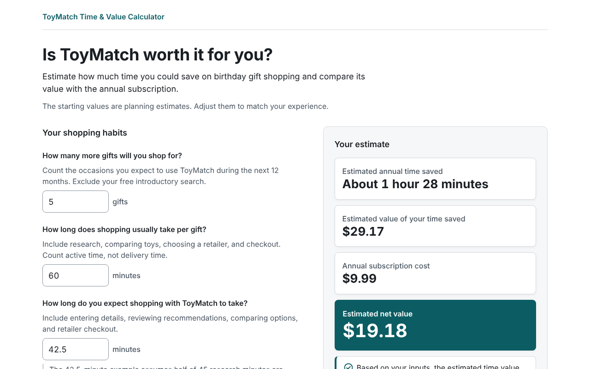

# ToyMatch Time & Value Calculator

A standalone web prototype that helps a gift shopper decide whether the proposed
**ToyMatch** annual subscription ($9.99) is worth it for *their own* habits.
It estimates the time saved each year and, optionally, what that time is worth
in dollars after subtracting the subscription. Low, zero and negative results
are shown plainly.

- Built with React, Vite and TypeScript, with plain CSS.
- Everything stays in the page: no saved data, cookies, backend or tracking.
- The math lives in a separate, tested module: `src/lib/calculate.ts`.



Demo video: [`demo/toymatch-demo.mp4`](demo/toymatch-demo.mp4) (also `demo/toymatch-demo.webm`).

## Run it on your computer

You need [Node.js](https://nodejs.org) (the "LTS" version). To check whether
it's installed, open Terminal and run `node -v`; if you see a version number, you're set.

```bash
npm install      # downloads the libraries (first time only)
npm run dev      # starts the app; open the address it prints, usually http://localhost:5173
```

Press `Ctrl + C` in Terminal to stop it.

## Run the tests

```bash
npm test             # unit tests of the calculations, formatting and validation (Vitest)
```

Browser tests (layout at 375px and 1280px, wording, validation, Reset, no
stored data, no outside requests) use Playwright. The first time, download
its browser:

```bash
npx playwright install chromium
npm run test:e2e     # also refreshes the screenshots in screenshots/
```

## Re-record the demo video

```bash
npm run demo:record
```

This builds the app, plays through the demo in Chromium at 1280×800 while
checking the key numbers on screen, and saves `demo/toymatch-demo.webm`. If
[ffmpeg](https://ffmpeg.org) is installed, it also saves `demo/toymatch-demo.mp4`.
On a Mac, install ffmpeg with `brew install ffmpeg`.

## Where things are

| File | What it does |
|---|---|
| `src/copy.ts` | Every label, help text and message, so wording can change without touching code |
| `src/lib/calculate.ts` | The formulas, rounding (display only) and number formatting |
| `src/lib/validate.ts` | Field rules, default values, error messages and the "complete the fields" state |
| `src/lib/calculate.test.ts` | Unit tests (the spec's acceptance cases) |
| `src/App.tsx` | The page layout and state |
| `src/components/` | Input field, results panel, "How this is calculated" |
| `src/styles.css` | All styling; colors and spacing are variables at the top |
| `tests-e2e/` | Playwright browser tests |
| `demo/` | Demo recording script and the recorded videos |

## Deploy on Vercel

Vercel detects Vite automatically: build command `npm run build`, output folder `dist`.
